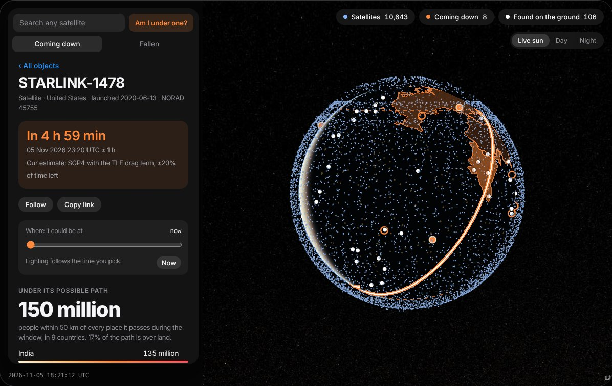

# Fallen

**Space debris lands everywhere. It mostly gets recorded in rich countries.**

Fallen is a live map of satellites and rocket bodies coming back to Earth. For each one it shows where it can come down,
who lives under that path and which country is liable if it hits someone. It also shows what has actually reached the
ground, and where debris has almost certainly landed without anyone recording it.

**Live site:** https://tilakkumar13.github.io/fallen/



## What it shows

| | |
|---|---|
| **Coming down** | Objects due to re-enter, soonest first, with live countdowns and their prediction window |
| **An honest path** | Every stretch of ground the object can cross while the window is open, never a single landing pin |
| **Who lives under it** | People within 50 km of the path, by country (JRC GHS-POP 2020) |
| **Who pays** | The launching state of each object under the 1972 UN Liability Convention |
| **Found on the ground** | 106 recorded finds since 1962 from ESA's list and a 16-language news search, each linked to its source |
| **Missing finds** | Each country's recorded finds against the number its exposure predicts |
| **Track record** | Every forecast is saved and scored against the actual re-entry, next to The Aerospace Corporation's |
| **Am I under one?** | Checks whether any object's path passes within 50 km of you |

## The finding

High-income countries hold **43%** of recorded debris finds but only **12%** of the exposure their orbits put over
people (75 recovered objects, 1962–2025, p ≈ 2e-11). At equal exposure, a country 10× richer has about 2.8× more recorded
finds. China has none on record against about 13 expected, and India has 4 against about 15. Finds reported only in
local-language news (Indonesia 2003 and 2007, Thailand 2017) are missing from the official list.

The record of what reaches the ground mostly shows who looks and reports, not where debris lands.
Method, statistics and caveats are in [`research/README.md`](research/README.md).

## Data

- **Orbits:** [CelesTrak](https://celestrak.org) (active satellites, decaying objects, SATCAT), refreshed by a scheduled GitHub Action.
- **Prediction windows:** [The Aerospace Corporation](https://aerospace.org/reentries) where they publish one. Otherwise our own
  estimate: SGP4 with the orbit's drag term, ±20% of the time left.
- **Population:** JRC [GHS-POP 2020](https://human-settlement.emergency.copernicus.eu/) (CC BY 4.0), summed to 0.25°.
- **Finds:** [ESA re-entry portal, recovered debris](https://reentry.esoc.esa.int/home/recovereddebris) (snapshot of 24 Oct 2026),
  plus a 16-language news search (`research/extra_events.csv`).
- **Liability:** owner and launch site from SATCAT, read against the
  [Liability Convention](https://www.unoosa.org/oosa/en/ourwork/spacelaw/treaties/liability-convention.html).
- **Map:** Natural Earth via world-atlas. Imagery: Esri World Imagery, NASA Black Marble (GIBS).

## Repository

```
docs/        the website (GitHub Pages) and its data files
pipeline/    update.py: fetches orbits and predictions, computes paths and exposure
research/    the analysis behind the finding (model.py, stats.py, data and README)
```

## Run it

```
pip install sgp4 numpy
python pipeline/update.py        # writes docs/data/live.json, sky.tle and track.json
python -m http.server -d docs    # open http://localhost:8000
```

## Cite

If you use the data or the finding, please cite it. GitHub shows a "Cite this repository" button generated from
[`CITATION.cff`](CITATION.cff).

## Licence

Code: MIT. Derived data and text: CC BY 4.0. Source data keeps its own terms (see Data). See [`LICENSE`](LICENSE).

Not an official warning service. For decisions, use your national space agency or ESA.

Made by [Tilak Kumar](https://tilakkumar13.github.io/), MSc Geospatial Technologies, University of Münster.
